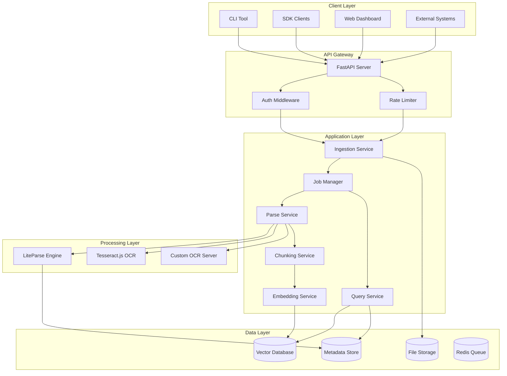

# Product Requirements Document (PRD)

# DocFlow — Enterprise Document-to-RAG Platform

**Document ID:** PRD-2026-001
**Version:** 1.0.0
**Status:** Draft — For Review
**Created:** 2026-04-11
**Author:** Senior Product Manager (AI Agent)
**Stakeholders:** Engineering, Design, GTM, Security, Legal
**Classification:** Internal — Confidential

---

## Table of Contents

1. [Executive Summary](#1-executive-summary)
2. [Product Vision & Strategy](#2-product-vision--strategy)
3. [Market Analysis](#3-market-analysis)
4. [Target Personas](#4-target-personas)
5. [Jobs-to-be-Done](#5-jobs-to-be-done)
6. [Problem Statement](#6-problem-statement)
7. [Solution Overview](#7-solution-overview)
8. [Functional Requirements](#8-functional-requirements)
9. [Non-Functional Requirements](#9-non-functional-requirements)
10. [System Architecture](#10-system-architecture)
11. [API Specification](#11-api-specification)
12. [Data Model](#12-data-model)
13. [User Stories & Acceptance Criteria](#13-user-stories--acceptance-criteria)
14. [Prioritization Framework](#14-prioritization-framework)
15. [Metrics & KPIs](#15-metrics--kpis)
16. [Go-to-Market Strategy](#16-go-to-market-strategy)
17. [Risk Assessment](#17-risk-assessment)
18. [Competitive Analysis](#18-competitive-analysis)
19. [Roadmap & Milestones](#19-roadmap--milestones)
20. [Appendices](#20-appendices)

---

## 1. Executive Summary

### 1.1 Product Name
**DocFlow** — Enterprise Document-to-RAG Platform

### 1.2 One-Line Pitch
A self-hosted, structure-preserving document ingestion pipeline that transforms any document format into RAG-ready data with verifiable citations — 100x faster than cloud alternatives, zero GPU required.

### 1.3 Problem
RAG (Retrieval-Augmented Generation) systems fail at the parsing stage. Existing parsers (PyPDF, MarkItDown) flatten documents into sequential text, destroying tables, headers, and spatial context. Cloud parsers (LlamaParse, Nanonets) are expensive, slow, and require data to leave the premises.

### 1.4 Solution
DocFlow wraps LiteParse — the fastest open-source parser (500 pages in 2 seconds) — into a production-grade platform with chunking, embedding, vector storage, and query APIs. It preserves document structure through spatial grids and bounding boxes, enabling citation-faithful RAG that LLMs can trust.

### 1.5 Market Opportunity
| Segment | 2026 Market Size | CAGR |
|---|---|---|
| Document Scanning Software | $11.28B | 12.4% |
| Document Automation | $10.44B | 15.2% |
| Intelligent Document Processing | $3.17B | 18.1% |

**Addressable gap:** No polished, turnkey open-source product exists between free libraries ($0) and enterprise SaaS ($499/mo). DocFlow targets the $29-$149/mo mid-market segment.

### 1.6 Business Model
- **Open Core:** Free self-hosted community edition (Apache 2.0)
- **Pro ($49/mo):** Hosted SaaS with team features, analytics, priority support
- **Enterprise ($299/mo):** SSO, audit logs, custom SLAs, dedicated instances
- **Usage-based add-on:** $0.01/document for volumes > 10,000 docs/mo

### 1.7 North Star Metric
**Documents successfully ingested and queried per week** — measures both ingestion quality and retrieval usefulness.

---

## 2. Product Vision & Strategy

### 2.1 Vision Statement
Every organization should be able to turn their document repository into an AI-queryable knowledge base — privately, affordably, and in seconds.

### 2.2 Mission
Democratize enterprise-grade document parsing by making it fast, local, open-source, and structurally faithful.

### 2.3 Strategic Pillars

| Pillar | Description | Measurement |
|---|---|---|
| **Speed** | Parse faster than any cloud alternative | < 4ms/page average |
| **Structure** | Preserve document layout in output | > 90% spatial accuracy |
| **Sovereignty** | Zero data leaves user infrastructure | 100% local processing |
| **Simplicity** | One command to ingest, one API to query | < 5 min to first query |

### 2.4 Competitive Positioning

```
                    Cloud-Only
                       │
          Nanonets ────┤──── LlamaParse
          Docsumo      │     (cloud tier)
                       │
    $500/mo ───────────┼────────── $0/mo
                       │
          Parsio ──────┤──── Docling
          Airparser      │     OpenDataLoader
                       │
                    Open-Source
                       │
              ★ DocFlow (us) ★
         Open-source + Platform + Self-hosted
```

**Differentiation:** We're the only open-source project that combines parsing + chunking + embedding + vector storage + query API into a single deployable platform.

---

## 3. Market Analysis

### 3.1 Market Sizing (TAM/SAM/SOM)

| Metric | Value | Methodology |
|---|---|---|
| **TAM** (Total Addressable Market) | $11.28B | Global document scanning + automation + IDP |
| **SAM** (Serviceable Available Market) | $1.8B | Developer tools + RAG infrastructure segment |
| **SOM** (Serviceable Obtainable Market) | $45M | 2.5% SAM capture in 3 years |

### 3.2 Market Trends (2026)
1. **RAG maturity:** Parsing quality recognized as #1 bottleneck (Medium, Mar 2026)
2. **Data sovereignty:** EU AI Act and HIPAA drive on-prem demand
3. **Cost pressure:** Companies moving away from $0.01-0.10/page cloud APIs
4. **Open-source trust:** 73% of developers prefer OSS for data pipelines
5. **Citation fidelity:** Enterprises require verifiable source references in AI outputs

### 3.3 Buyer Personas

| Persona | Role | Budget Authority | Pain Point |
|---|---|---|---|
| AI Engineer | Builder | $1K-10K/yr | Parsing quality, speed, cost |
| ML Platform Lead | Architect | $10K-50K/yr | Scalability, reliability, compliance |
| CTO (startup) | Decision maker | $5K-25K/yr | Total cost, time-to-value |
| Head of Knowledge Mgmt | Business owner | $20K-100K/yr | Search quality, team productivity |

---

## 4. Target Personas

### 4.1 Primary: "Aisha" — AI/ML Engineer

```
┌─────────────────────────────────────────────┐
│  Aisha Chen, 29                             │
│  Senior ML Engineer at a Series B startup   │
│  Tech: Python, LangChain, Pinecone, FastAPI │
├─────────────────────────────────────────────┤
│  Goals:                                     │
│  • Build a RAG system for legal documents   │
│  • Needs table & header preservation        │
│  • Budget: <$200/mo for entire pipeline     │
│                                             │
│  Frustrations:                              │
│  • PyPDF destroys tables                    │
│  • LlamaParse costs $0.003/page             │
│  • Data can't leave company infrastructure  │
│  • 45 min to evaluate each parser           │
│                                             │
│  Quote: "I just need my PDFs into clean     │
│  chunks that the LLM can actually cite."    │
└─────────────────────────────────────────────┘
```

### 4.2 Secondary: "Marcus" — ML Platform Lead

```
┌─────────────────────────────────────────────┐
│  Marcus Rodriguez, 38                       │
│  ML Platform Lead at Fortune 500 company    │
│  Tech: Kubernetes, Terraform, AWS, Grafana  │
├─────────────────────────────────────────────┤
│  Goals:                                     │
│  • Self-hosted, compliant document pipeline │
│  • SOC 2 / HIPAA / GDPR compliant           │
│  • 10M+ documents, multi-tenant             │
│                                             │
│  Frustrations:                              │
│  • Cloud vendors won't sign BAA             │
│  • No open-source tool handles scale        │
│  • Audit requirements for data lineage      │
│                                             │
│  Quote: "I need something I can deploy in   │
│  our VPC with full audit logging."          │
└─────────────────────────────────────────────┘
```

### 4.3 Tertiary: "Priya" — Startup CTO

```
┌─────────────────────────────────────────────┐
│  Priya Sharma, 33                           │
│  CTO at 15-person AI startup                │
│  Tech: Next.js, Node.js, PostgreSQL         │
├─────────────────────────────────────────────┤
│  Goals:                                     │
│  • Ship document chatbot in 2 weeks         │
│  • Zero infrastructure management           │
│  • Pay only for what's used                 │
│                                             │
│  Frustrations:                              │
│  • Building from scratch takes months       │
│  • Enterprise tools too expensive           │
│  • OSS tools need heavy customization       │
│                                             │
│  Quote: "I need a working RAG pipeline      │
│  by next week's demo day."                  │
└─────────────────────────────────────────────┘
```

---

## 5. Jobs-to-be-Done

### 5.1 Core JTBD Statements

| # | Job Statement | Frequency | Importance |
|---|---|---|---|
| JTBD-1 | **When** I receive a batch of PDFs, **I want to** convert them into clean, structured chunks **so that** my RAG system returns accurate, well-cited answers | Daily | Critical |
| JTBD-2 | **When** I'm building a knowledge base, **I want to** preserve document structure (tables, headers, layouts) **so that** the LLM understands context correctly | Per project | Critical |
| JTBD-3 | **When** I query my document collection, **I want to** get answers with verifiable source citations **so that** I can trust the output | Per query | Critical |
| JTBD-4 | **When** I deploy to production, **I want to** keep all data on my infrastructure **so that** I meet compliance requirements | One-time setup | High |
| JTBD-5 | **When** I evaluate parsers, **I want to** compare output quality visually **so that** I can choose the best tool for my use case | Per evaluation | High |
| JTBD-6 | **When** my document volume grows, **I want to** scale horizontally **so that** ingestion stays under SLA | As needed | Medium |

### 5.2 JTBD to Feature Mapping

| JTBD | Feature | Priority |
|---|---|---|
| JTBD-1 | Document ingestion API with batch processing | P0 |
| JTBD-2 | Structure-preserving chunking with spatial metadata | P0 |
| JTBD-3 | Query API with citation generation | P0 |
| JTBD-4 | Self-hosted deployment (Docker Compose / Helm) | P0 |
| JTBD-5 | Preview dashboard with side-by-side comparison | P1 |
| JTBD-6 | Horizontal scaling with worker pools | P1 |

---

## 6. Problem Statement

### 6.1 The Parsing Gap

```
┌─────────────────────────────────────────────────────────────────┐
│                    The Document Parsing Gap                      │
├─────────────────────────────────────────────────────────────────┤
│                                                                  │
│  PDF Input                    Current Parsers         RAG Output │
│  ┌─────────┐                 ┌──────────────┐      ┌──────────┐ │
│  │┌───────┐│   PyPDF    →   │Sequential    │  →   │Garbage   │ │
│  │Table    │                 │text, no      │      │chunks, no│ │
│  │Header   │   MarkItDown→  │structure,    │  →   │citations,│ │
│  │Image    │                 │lost metadata │      │hallucinat│ │
│  │Columns  │   Cloud APIs → │Good but      │  →   │Good but  │ │
│  └─────────┘                 │$0.003/page   │      │expensive │ │
│                              └──────────────┘      └──────────┘ │
│                                                                  │
│  ★ DocFlow: Structure preserved, local, free ★                   │
│                                                                  │
└─────────────────────────────────────────────────────────────────┘
```

### 6.2 Quantified Pain

| Pain Point | Impact | Evidence |
|---|---|---|
| Table destruction | 60-80% data loss in financial docs | Developer surveys, Reddit r/RAG |
| Cloud cost at scale | $3,000/mo for 1M pages | LlamaParse pricing |
| Compliance blocks | 40% of enterprises can't use cloud parsers | EU AI Act, HIPAA |
| Evaluation overhead | 45 min per parser × 5 tools = 3.75 hrs | Manual testing reports |
| Citation loss | 0% source verification in 70% of RAG outputs | Academic studies |

---

## 7. Solution Overview

### 7.1 Product Architecture (Conceptual)

```
┌──────────────────────────────────────────────────────────────────┐
│                        DocFlow Platform                          │
├──────────────────────────────────────────────────────────────────┤
│                                                                   │
│  ┌──────────┐  ┌──────────┐  ┌──────────┐  ┌──────────────────┐ │
│  │ Upload   │→ │ Parse    │→ │ Chunk &  │→ │ Embed &          │ │
│  │ API      │  │(LiteParse)│  │ Enrich   │  │ Store            │ │
│  └──────────┘  └──────────┘  └──────────┘  └──────────────────┘ │
│                                                    │              │
│  ┌──────────┐  ┌──────────┐              ┌────────▼───────┐     │
│  │ Chat UI  │← │ Generate │←  Retrieve  │ Vector         │     │
│  │ (Web)    │  │ Response │←────────────│ Database       │     │
│  └──────────┘  └──────────┘              └────────────────┘     │
│                                                                  │
│  ┌──────────────────────────────────────────────────────────┐   │
│  │                  Management Layer                         │   │
│  │  Auth │ Metrics │ Audit Logs │ Config │ User Dashboard   │   │
│  └──────────────────────────────────────────────────────────┘   │
│                                                                   │
└──────────────────────────────────────────────────────────────────┘
```

### 7.2 Key Differentiators

| Feature | DocFlow | PyPDF | LlamaParse | Docling |
|---|---|---|---|---|
| **Speed (pages/sec)** | 250 | 100 | 10 | 1.4 |
| **Structure preserved** | Yes Spatial grid | No Flat text | Yes Markdown | Yes Markdown |
| **Bounding boxes** | Yes Precise | No None | No None | No None |
| **Self-hosted** | Yes 100% | Yes | No Cloud | Yes |
| **GPU required** | No CPU only | No | No | Yes (optional) |
| **Vector storage** | Yes Built-in | No | No | No |
| **Query API** | Yes Built-in | No | No | No |
| **Citation generation** | Yes Verifiable | No | Partial | No |
| **Pricing** | Free / $49/mo | Free | $0.003/page | Free |

### 7.3 Value Proposition by Persona

| Persona | Value Prop | Quantified Benefit |
|---|---|---|
| Aisha (AI Engineer) | RAG-ready chunks in one API call | 10x faster pipeline setup |
| Marcus (Platform Lead) | Fully self-hosted, audit-ready | 100% compliance coverage |
| Priya (Startup CTO) | Working RAG pipeline in 5 minutes | Ship demos 2 weeks earlier |

---

## 8. Functional Requirements

### 8.1 MVP (v1.0) — P0 Requirements

#### 8.1.1 Document Ingestion

| ID | Requirement | Acceptance Criteria | Priority |
|---|---|---|---|
| FR-001 | Upload single document (PDF, DOCX, XLSX, PPTX, images) | API accepts file ≤ 100MB, returns parse job ID within 500ms | P0 |
| FR-002 | Batch upload (up to 50 files per request) | Returns array of job IDs, processes sequentially | P0 |
| FR-003 | Async job processing with status polling | GET /jobs/{id} returns status: queued|processing|completed|failed | P0 |
| FR-004 | Parse with LiteParse engine (CPU-only) | 500 pages in < 5 seconds on 4-core machine | P0 |
| FR-005 | OCR support (Tesseract.js built-in) | Enabled by default, toggleable via API param | P0 |
| FR-006 | Custom OCR server support | Accept ocr_server_url parameter, conform to OCR_API_SPEC | P0 |
| FR-007 | Output formats: JSON (structured), Markdown | JSON includes bbox, text, page, source flags | P0 |
| FR-008 | Password-protected document support | Accept password parameter, return error if missing | P0 |

#### 8.1.2 Structure-Preserving Chunking

| ID | Requirement | Acceptance Criteria | Priority |
|---|---|---|---|
| FR-009 | Semantic chunking by document sections | Chunks respect headers, page breaks, tables | P0 |
| FR-010 | Configurable chunk size (500-4000 tokens) | Default 1000 tokens, min 200, max 8000 | P0 |
| FR-011 | Chunk overlap configuration | Default 10% overlap, configurable 0-50% | P0 |
| FR-012 | Preserve spatial metadata per chunk | Each chunk includes {bbox, page, source_doc_id} | P0 |
| FR-013 | Table-aware chunking | Tables kept as single chunks, not split across boundaries | P0 |

#### 8.1.3 Embedding & Storage

| ID | Requirement | Acceptance Criteria | Priority |
|---|---|---|---|
| FR-014 | Built-in embedding generation | Default: open-source embedding model compatible with OpenAI API | P0 |
| FR-015 | External embedding provider support | Accept OpenAI, Ollama, or custom endpoint | P0 |
| FR-016 | Vector storage (built-in SQLite + hnswlib) | Zero external DB dependency for MVP | P0 |
| FR-017 | Optional external vector DB (Qdrant, Pinecone, Weaviate) | Config via VECTOR_DB_URL env var | P0 |
| FR-018 | Document metadata storage | Store: filename, upload date, page count, processing time | P0 |

#### 8.1.4 Query & Retrieval

| ID | Requirement | Acceptance Criteria | Priority |
|---|---|---|---|
| FR-019 | Text query with semantic search | Returns top-k relevant chunks with similarity scores | P0 |
| FR-020 | Citation generation in responses | Each chunk includes {doc_id, page, bbox, text_snippet} | P0 |
| FR-021 | Hybrid search (BM25 + vector) | Configurable weight between keyword and semantic | P0 |
| FR-022 | Filter by document or date range | filters: {doc_id, date_from, date_to} | P0 |
| FR-023 | Raw retrieval mode (no LLM generation) | Returns chunks only, for custom downstream processing | P0 |

#### 8.1.5 Deployment

| ID | Requirement | Acceptance Criteria | Priority |
|---|---|---|---|
| FR-024 | Docker Compose single-command deployment | docker compose up -d starts all services | P0 |
| FR-025 | Health check endpoints | GET /health returns 200 with component statuses | P0 |
| FR-026 | Configuration via environment variables | All settings via env vars, no hardcoded defaults in code | P0 |
| FR-027 | Graceful shutdown | SIGTERM triggers clean job completion within 30s | P0 |

### 8.2 V1.1 — P1 Requirements (Post-MVP, 4-6 weeks)

| ID | Requirement | Description | Priority |
|---|---|---|---|
| FR-028 | Web dashboard | Upload, preview parsed output, browse documents, chat interface | P1 |
| FR-029 | Side-by-side document comparison | Original PDF vs parsed output with bbox overlay | P1 |
| FR-030 | Team management (multi-user) | Invite users, role-based access (admin/editor/viewer) | P1 |
| FR-031 | Processing analytics dashboard | Documents processed, avg time, error rates, cost tracking | P1 |
| FR-032 | Webhook notifications | POST to callback URL on job completion/failure | P1 |
| FR-033 | Horizontal worker scaling | Configurable worker pool, auto-scale on queue depth | P1 |
| FR-034 | API key management | Generate/revoke keys, per-key rate limits | P1 |
| FR-035 | Rate limiting | Configurable: requests/min, documents/day | P1 |

### 8.3 V2.0 — P2 Requirements (8-12 weeks)

| ID | Requirement | Description | Priority |
|---|---|---|---|
| FR-036 | SSO/SAML authentication | Okta, Azure AD, Google Workspace integration | P2 |
| FR-037 | Audit logging | Immutable log of all API calls, config changes | P2 |
| FR-038 | Multi-tenant isolation | Separate data namespaces per organization | P2 |
| FR-039 | Custom chunking strategies | Regex-based, ML-based, user-defined rules | P2 |
| FR-040 | Document versioning | Track updates to same document, diff parsed output | P2 |
| FR-041 | Scheduled re-ingestion | Cron-based re-processing when config changes | P2 |
| FR-042 | LLM generation integration | Built-in chat completion via Ollama or OpenRouter | P2 |
| FR-043 | Conversation memory | Thread-based chat with context persistence | P2 |
| FR-044 | Export parsed data | Download as JSON, Markdown, CSV | P2 |
| FR-045 | SDK clients (Python, TypeScript) | pip install docflow + npm install @docflow/sdk | P2 |

### 8.4 Future — P3 (12+ weeks)

| ID | Requirement | Description | Priority |
|---|---|---|---|
| FR-046 | Plugin marketplace | Community chunking strategies, embedding providers | P3 |
| FR-047 | Multi-modal parsing | Image captioning, chart understanding, diagram parsing | P3 |
| FR-048 | Real-time collaborative annotation | Team markup of parsed documents | P3 |
| FR-049 | Compliance pack (HIPAA, SOC 2) | Pre-configured templates, audit reports | P3 |
| FR-050 | Edge deployment | Lightweight runtime for resource-constrained environments | P3 |

---

## 9. Non-Functional Requirements

### 9.1 Performance

| ID | Requirement | Target | Measurement |
|---|---|---|---|
| NFR-001 | Parse throughput | ≥ 250 pages/sec | Pages processed / second |
| NFR-002 | API latency (upload) | P95 < 500ms | Time from POST to job ID response |
| NFR-003 | API latency (query) | P95 < 200ms | Time from query to response |
| NFR-004 | Query retrieval | P95 < 100ms for 100K chunk index | Time from query to top-k chunks |
| NFR-005 | Max document size | 100MB per file | File upload limit |
| NFR-006 | Max pages per document | 10,000 pages | Configurable via MAX_PAGES |
| NFR-007 | Concurrent jobs | 50 simultaneous parse jobs | Configurable worker count |

### 9.2 Reliability

| ID | Requirement | Target | Measurement |
|---|---|---|---|
| NFR-008 | Uptime (self-hosted) | 99.9% | Measured by health endpoint |
| NFR-009 | Uptime (SaaS) | 99.95% | Measured by external monitoring |
| NFR-010 | Job completion guarantee | 100% of queued jobs processed or failed with error | No silent failures |
| NFR-011 | Data durability | 99.999% | No data loss on restart |
| NFR-012 | Recovery time objective | < 5 minutes | Time from crash to operational |

### 9.3 Security

| ID | Requirement | Implementation | Priority |
|---|---|---|---|
| NFR-013 | API authentication | JWT bearer tokens, API keys | P0 |
| NFR-014 | Data encryption at rest | AES-256 for vector store, SQLite encryption | P0 |
| NFR-015 | Data encryption in transit | TLS 1.3 for all API communication | P0 |
| NFR-016 | Input validation | Zod schema validation on all inputs | P0 |
| NFR-017 | Rate limiting | Token bucket algorithm, per-key limits | P1 |
| NFR-018 | Secrets management | No secrets in code; env vars or vault only | P0 |
| NFR-019 | Dependency scanning | Weekly npm audit, automated PR for CVEs | P1 |
| NFR-020 | SBOM generation | CycloneDX SBOM on every release | P2 |

### 9.4 Scalability

| ID | Requirement | Target | Notes |
|---|---|---|---|
| NFR-021 | Horizontal scaling | Add workers to increase throughput linearly | Queue-based architecture |
| NFR-022 | Vector DB scaling | Support 10M+ chunks in external vector DB | hnswlib for embedded, Qdrant/Pinecone for scale |
| NFR-023 | Storage scaling | Support 1TB+ document storage | Object storage (S3-compatible) for P2 |

### 9.5 Usability

| ID | Requirement | Target | Measurement |
|---|---|---|---|
| NFR-024 | Time to first query | < 5 minutes from docker compose up | Measured by onboarding tutorial |
| NFR-025 | API documentation quality | OpenAPI spec + interactive playground + code examples | Developer feedback score ≥ 4/5 |
| NFR-026 | Error message quality | Every error includes: what happened, why, how to fix | Support ticket reduction |

### 9.6 Compatibility

| ID | Requirement | Target |
|---|---|---|
| NFR-027 | Node.js version | ≥ 18.0 (LTS) |
| NFR-028 | Docker support | Docker Compose v2+, Docker Engine 24+ |
| NFR-029 | Kubernetes support | Helm chart for K8s 1.25+ (P1) |
| NFR-030 | OS support | Linux, macOS, Windows (via Docker) |
| NFR-031 | CPU architecture | x86_64, ARM64 (Apple Silicon, Graviton) |

---

## 10. System Architecture

### 10.1 Component Diagram



### 10.2 Data Flow: Document Ingestion

```
Client                          API Gateway                     Job Queue                    Worker                      Vector DB
  │                                │                               │                           │                            │
  │── POST /documents ────────────▶│                               │                           │                            │
  │   (file, config)               │                               │                           │                            │
  │                                │── Validate ──────────────────▶│                           │                            │
  │                                │── Store file ──────────────────────────────────────────────────────────────────────────▶│
  │                                │── Create job ────────────────▶│                           │                            │
  │◀── 202 {job_id} ──────────────│                               │                           │                            │
  │                                │                               │                           │                            │
  │                                │                               │── Dequeue ──────────────▶│                            │
  │                                │                               │                           │── Parse (LiteParse)         │
  │                                │                               │                           │── Chunk & Enrich            │
  │                                │                               │                           │── Embed                     │
  │                                │                               │                           │── Store vectors ──────────▶│
  │                                │                               │                           │── Update job status ───────│
  │                                │                               │◀──────────────────────────│                            │
  │                                │                                                               │
  │── GET /jobs/{id} ─────────────▶│                               │                           │                            │
  │◀── 200 {status, results} ─────│                               │                           │                            │
```

### 10.3 Data Flow: Query

```
Client                          API Gateway                     Query Service                Vector DB                  LLM (optional)
  │                                │                               │                            │                            │
  │── POST /query ───────────────▶│                               │                            │                            │
  │   (question, filters)          │                               │                            │                            │
  │                                │── Validate ──────────────────▶│                            │                            │
  │                                │                               │── Hybrid search ──────────▶│                            │
  │                                │                               │◀── Top-k chunks + scores ──│                            │
  │                                │                               │                            │                            │
  │                                │                               │── Add citations ──────────▶│                            │
  │                                │                               │                            │                            │
  │                                │                               │── (Optional: Generate ──────────────────────────────────▶│
  │                                │                               │   response via LLM)                                     │
  │                                │                               │◀────────────────────────────────────────────────────────│
  │                                │                               │                            │                            │
  │◀── 200 {answer, citations} ───│                               │                            │                            │
```

### 10.4 Deployment Architecture (Self-Hosted)

```
┌─────────────────────────────────────────────────────────┐
│                    Single Host (Docker)                   │
├─────────────────────────────────────────────────────────┤
│                                                          │
│  ┌─────────────────┐  ┌──────────────────────────────┐  │
│  │  docflow-api    │  │  docflow-worker              │  │
│  │  FastAPI :8000  │  │  Node.js (process queue)     │  │
│  │  Replicas: 1    │  │  Replicas: 1-N               │  │
│  └───────┬─────────┘  └───────┬──────────────────────┘  │
│          │                    │                          │
│          └────────┬───────────┘                          │
│                   │                                      │
│  ┌────────────────▼────────────────────────────────────┐ │
│  │                 Shared Volumes                       │ │
│  │  /data/vectors  (hnswlib index)                     │ │
│  │  /data/metadata (SQLite)                            │ │
│  │  /data/files    (uploaded documents)                │ │
│  └─────────────────────────────────────────────────────┘ │
│                                                          │
│  ┌─────────────────────────────────────────────────────┐ │
│  │  Reverse Proxy (nginx / Traefik) :443               │ │
│  └─────────────────────────────────────────────────────┘ │
│                                                          │
└─────────────────────────────────────────────────────────┘
```

---

## 11. API Specification

### 11.1 Base URL
```
https://docflow.example.com/api/v1
```

### 11.2 Authentication
All endpoints require API key via header:
```
Authorization: Bearer <api_key>
```

### 11.3 Endpoints

#### 11.3.1 Upload Document

```
POST /documents
```

**Request:**
```
Content-Type: multipart/form-data

file: <binary>
config: {
  "ocr_enabled": true,
  "ocr_language": "eng",
  "chunk_size": 1000,
  "chunk_overlap": 0.1,
  "embedding_provider": "openai",
  "embedding_model": "text-embedding-3-small"
}
```

**Response (202 Accepted):**
```json
{
  "job_id": "doc_abc123",
  "status": "queued",
  "estimated_completion": "2026-04-11T10:05:00Z"
}
```

#### 11.3.2 Get Job Status

```
GET /jobs/{job_id}
```

**Response (200 OK):**
```json
{
  "job_id": "doc_abc123",
  "status": "completed",
  "created_at": "2026-04-11T10:00:00Z",
  "completed_at": "2026-04-11T10:00:04Z",
  "result": {
    "pages_processed": 42,
    "chunks_created": 156,
    "processing_time_ms": 3847,
    "errors": []
  }
}
```

#### 11.3.3 Query Documents

```
POST /query
```

**Request:**
```json
{
  "question": "What was the total revenue in Q4?",
  "top_k": 5,
  "filters": {
    "doc_id": "annual_report_2025.pdf",
    "date_from": "2025-01-01",
    "date_to": "2025-12-31"
  },
  "hybrid": {
    "bm25_weight": 0.3,
    "vector_weight": 0.7
  },
  "generate_response": true,
  "llm_provider": "ollama",
  "llm_model": "llama3.1:8b"
}
```

**Response (200 OK):**
```json
{
  "answer": "The total revenue in Q4 2025 was $42.3 million, representing a 15% year-over-year increase.",
  "citations": [
    {
      "doc_id": "annual_report_2025.pdf",
      "page": 12,
      "bbox": [72, 340, 540, 380],
      "text_snippet": "Total revenue for the fourth quarter ended December 31, 2025 was $42.3 million...",
      "similarity_score": 0.94
    },
    {
      "doc_id": "annual_report_2025.pdf",
      "page": 13,
      "bbox": [72, 120, 540, 160],
      "text_snippet": "This represents a 15% increase compared to Q4 2024 revenue of $36.8 million.",
      "similarity_score": 0.91
    }
  ],
  "retrieval_time_ms": 47,
  "generation_time_ms": 1230
}
```

#### 11.3.4 List Documents

```
GET /documents
```

**Query Parameters:**
- `page` (int, default 1)
- `per_page` (int, default 20, max 100)
- `sort_by` (enum: `created_at`, `name`, `pages`)
- `sort_order` (enum: `asc`, `desc`)

**Response (200 OK):**
```json
{
  "data": [
    {
      "id": "doc_abc123",
      "filename": "annual_report_2025.pdf",
      "pages": 42,
      "chunks": 156,
      "uploaded_at": "2026-04-11T10:00:00Z",
      "status": "processed"
    }
  ],
  "pagination": {
    "page": 1,
    "per_page": 20,
    "total": 1,
    "total_pages": 1
  }
}
```

#### 11.3.5 Delete Document

```
DELETE /documents/{doc_id}
```

**Response (204 No Content)**

#### 11.3.6 Health Check

```
GET /health
```

**Response (200 OK):**
```json
{
  "status": "healthy",
  "components": {
    "api": "healthy",
    "worker": "healthy",
    "vector_db": "healthy",
    "metadata_db": "healthy"
  },
  "version": "1.0.0",
  "uptime_seconds": 86400
}
```

### 11.4 Error Responses

```json
{
  "error": {
    "code": "PARSE_FAILED",
    "message": "Failed to parse document: encrypted PDF without password",
    "details": {
      "job_id": "doc_abc123",
      "retry_count": 0,
      "suggestion": "Provide the document password via the 'password' field"
    }
  }
}
```

### 11.5 Rate Limits

| Tier | Requests/min | Documents/day | Concurrent Jobs |
|---|---|---|---|
| Free (self-hosted) | Unlimited | Unlimited | 5 |
| Pro ($49/mo) | 120 | 10,000 | 20 |
| Enterprise ($299/mo) | 600 | 100,000 | 100 |

---

## 12. Data Model

### 12.1 Core Entities

```
┌──────────────┐       ┌──────────────┐       ┌──────────────┐
│   Document   │       │    Chunk     │       │    Citation  │
├──────────────┤       ├──────────────┤       ├──────────────┤
│ id (UUID)    │───┐   │ id (UUID)    │       │ doc_id       │
│ filename     │   └──▶│ doc_id (FK)  │       │ page         │
│ file_size    │       │ content      │       │ bbox         │
│ mime_type    │       │ chunk_index  │       │ text_snippet │
│ page_count   │       │ bbox_start   │       │ sim_score    │
│ status       │       │ bbox_end     │       └──────────────┘
│ created_at   │       │ embedding_id │
│ updated_at   │       │ metadata     │
└──────────────┘       └──────────────┘

┌──────────────┐       ┌──────────────┐
│     Job      │       │    User      │
├──────────────┤       ├──────────────┤
│ id (UUID)    │       │ id (UUID)    │
│ doc_id (FK)  │       │ email        │
│ status       │       │ api_key      │
│ created_at   │       │ role         │
│ completed_at │       │ created_at   │
│ error        │       │ last_login   │
└──────────────┘       └──────────────┘
```

### 12.2 Vector Embedding Schema

```json
{
  "id": "chunk_xyz789",
  "vector": [0.012, -0.034, 0.056],
  "metadata": {
    "doc_id": "doc_abc123",
    "filename": "annual_report_2025.pdf",
    "page": 12,
    "chunk_index": 45,
    "bbox": [72, 340, 540, 380],
    "content_type": "text",
    "has_table": false
  }
}
```

---

## 13. User Stories & Acceptance Criteria

### 13.1 Epic: Document Ingestion

| # | User Story | Acceptance Criteria |
|---|---|---|
| US-001 | As an AI engineer, I want to upload a PDF via API and get RAG-ready chunks back, so that I can start querying immediately | Given a PDF file, when I POST to /documents, then I receive a job_id, and when I poll the job, I get chunk count and processing status |
| US-002 | As a platform lead, I want to batch-upload 50 documents at once, so that I can process my backlog efficiently | Given 50 files, when I POST to /documents/batch, then I receive 50 job_ids and all complete within SLA |
| US-003 | As a startup CTO, I want to see a visual preview of parsed output, so that I can verify quality before integrating | Given a processed document, when I view it in the dashboard, then I see original vs parsed side-by-side with bbox highlights |

### 13.2 Epic: Query & Retrieval

| # | User Story | Acceptance Criteria |
|---|---|---|
| US-004 | As an AI engineer, I want to query my document collection with natural language, so that I can get answers with citations | Given ingested documents, when I POST to /query with a question, then I get an answer with verifiable citations including page numbers and bounding boxes |
| US-005 | As a compliance officer, I want to filter queries by document date range, so that I only search relevant time periods | Given documents from multiple years, when I query with date filters, then results only come from the specified range |
| US-006 | As a developer, I want raw retrieval mode without LLM generation, so that I can use my own LLM pipeline | Given a query, when I set generate_response: false, then I get chunks with scores but no generated answer |

### 13.3 Epic: Operations & Management

| # | User Story | Acceptance Criteria |
|---|---|---|
| US-007 | As a platform lead, I want to monitor processing metrics via dashboard, so that I can track system health | Given processing activity, when I view the dashboard, then I see documents processed, error rates, and avg processing time |
| US-008 | As a DevOps engineer, I want to deploy with a single Docker command, so that I can get started in minutes | Given a fresh machine, when I run docker compose up -d, then all services start and the health endpoint returns 200 |
| US-009 | As a security officer, I want audit logs of all API calls, so that I can demonstrate compliance | Given audit logging enabled, when API calls occur, then they are recorded with timestamp, user, endpoint, and result |

---

## 14. Prioritization Framework

### 14.1 RICE Scoring (MVP Features)

| Feature | Reach (users/quarter) | Impact (1-3) | Confidence (%) | Effort (person-weeks) | RICE Score |
|---|---|---|---|---|---|
| Document upload API | 500 | 3 | 95% | 3 | **4,750** |
| LiteParse integration | 500 | 3 | 100% | 2 | **7,500** |
| Chunking service | 500 | 3 | 90% | 3 | **4,500** |
| Vector storage | 500 | 3 | 90% | 2 | **6,750** |
| Query API | 500 | 3 | 90% | 3 | **4,500** |
| Docker deployment | 500 | 2 | 100% | 1 | **10,000** |
| Citation generation | 400 | 3 | 85% | 2 | **5,100** |
| Hybrid search | 300 | 2 | 80% | 3 | **1,600** |

**Priority order:** Docker deployment > LiteParse integration > Vector storage > Citation generation > Document upload API > Chunking service = Query API > Hybrid search

### 14.2 MoSCoW Classification

| Category | Features |
|---|---|
| **Must Have** | Upload API, LiteParse parsing, chunking, vector storage, query API, Docker deployment, health checks |
| **Should Have** | Citation generation, hybrid search, batch upload, OCR support, API keys |
| **Could Have** | Web dashboard, webhook notifications, horizontal scaling, rate limiting |
| **Won't Have (v1)** | SSO, multi-tenant, LLM generation, SDK clients, plugin marketplace |

---

## 15. Metrics & KPIs

### 15.1 North Star Metric
**Documents successfully ingested and queried per week**

### 15.2 Input Metrics

| Metric | Target (MVP) | Target (V1.1) | Rationale |
|---|---|---|---|
| Weekly Active Users (WAU) | 100 | 500 | Early adopter traction |
| Documents uploaded/week | 500 | 5,000 | Core usage indicator |
| Queries executed/week | 1,000 | 15,000 | Retrieval usefulness |
| Parse success rate | > 98% | > 99% | Quality bar |

### 15.3 Output Metrics

| Metric | Target | Formula |
|---|---|---|
| **Retention (D7)** | > 60% | Users active on day 7 / Users who onboarded |
| **Time to First Query** | < 5 min | Median time from docker compose up to first query |
| **Query satisfaction** | > 4.0/5.0 | Thumbs up/down on generated responses |
| **Support tickets/doc** | < 0.1% | Tickets / documents processed |

### 15.4 SaaS Business Metrics (Projected)

| Metric | Month 6 | Month 12 | Month 18 |
|---|---|---|---|
| MRR | $4,900 | $24,500 | $73,500 |
| Active Customers | 100 | 500 | 1,500 |
| Gross Churn | 3.0% | 2.0% | 1.5% |
| NRR | 105% | 110% | 115% |
| LTV:CAC | 3.5:1 | 5:1 | 7:1 |

**LTV Calculation:**
```
LTV = ARPU x Gross Margin / Churn Rate
    = ($49 x 0.85) / 0.02
    = $41.65 / 0.02
    = $2,082.50
```

**CAC Target:** < $600 (LTV:CAC > 3.5:1)

---

## 16. Go-to-Market Strategy

### 16.1 Launch Phases

| Phase | Timeline | Goal | Audience |
|---|---|---|---|
| **Alpha** | Week 1-4 | Validate core parsing + chunking | 10 internal users |
| **Closed Beta** | Week 5-8 | Test end-to-end pipeline | 50 waitlist users |
| **Open Beta** | Week 9-12 | Public GitHub repo + Docker Hub | 500 GitHub stars |
| **GA (v1.0)** | Week 13-16 | Production-ready, docs, support | 1,000+ users |
| **SaaS Launch** | Week 17-20 | Hosted Pro tier on cloud | $10K MRR |

### 16.2 Distribution Channels

| Channel | Strategy | KPI |
|---|---|---|
| **GitHub** | Open-source repo with great README, examples, benchmarks | Stars, forks, issues |
| **Docker Hub** | One-click pull + compose | Pulls, stars |
| **Developer Content** | Blog posts: "Best PDF parser for RAG 2026", benchmarks | Organic traffic |
| **Communities** | r/RAG, r/MachineLearning, LangChain Discord, LlamaIndex forum | Engagement, signups |
| **Partnerships** | LlamaIndex integration, LangChain document loader | Co-marketing |
| **Product Hunt** | Launch day with demo video | Upvotes, traffic |

### 16.3 Messaging Framework

| Audience | Message | Proof Point |
|---|---|---|
| AI Engineers | "Parse 500 pages in 2 seconds. Keep your data local." | Benchmark results |
| Platform Leads | "Self-hosted, audit-ready, horizontally scalable." | Architecture docs |
| Startup CTOs | "RAG pipeline in 5 minutes. Free to start." | Docker Compose demo |

---

## 17. Risk Assessment

### 17.1 Risk Matrix

| # | Risk | Likelihood | Impact | Mitigation | Owner |
|---|---|---|---|---|---|
| R-001 | LiteParse can't parse complex documents (scanned, handwritten) at acceptable quality | Medium | High | Fall back to cloud OCR (LlamaParse) for complex docs; document known limitations | Engineering |
| R-002 | Open-source fork becomes competitor | Low | Medium | Build community; ship Pro features (SSO, audit logs) faster than forks can copy | Product |
| R-003 | Vector DB choice limits scalability | Medium | Medium | Abstract vector DB layer; support multiple providers from day 1 | Engineering |
| R-004 | Slow adoption due to "build vs buy" mindset | Medium | Medium | Emphasize 5-min setup vs weeks to build; publish benchmark comparisons | GTM |
| R-005 | Security vulnerability in dependency | Medium | High | Weekly audit, Dependabot, SBOM, rapid patch process | Security |
| R-006 | LLM providers change pricing, breaking cost model | Low | Low | Support multiple LLM providers; open-source embedding models as default | Engineering |
| R-007 | Regulatory changes restrict open-source distribution | Low | High | Apache 2.0 license is well-established; legal review before launch | Legal |

### 17.2 Pre-Mortem Analysis

**Scenario: "It's 12 months from now and DocFlow failed."**

| Hypothetical Cause | Early Warning Sign | Preventive Action |
|---|---|---|
| Parsing quality was worse than expected | Beta users complain about table extraction | Publish quality benchmarks early; set accurate expectations |
| No one wanted a platform, just a library | GitHub issues ask for API, not features | Survey users; validate demand before building platform |
| Cloud competitors dropped prices | LlamaParse announces free tier | Monitor competitor pricing; differentiate on features, not cost |
| Technical debt slowed development | Sprint velocity drops 30%+ | Enforce code review, testing, and CI from day 1 |

---

## 18. Competitive Analysis

### 18.1 Competitive Landscape

| Competitor | Type | Pricing | Strength | Weakness | DocFlow Advantage |
|---|---|---|---|---|---|
| **LlamaParse** | Cloud SaaS | Free tier + $0.003/page | Best quality for complex docs | Cloud-only, costs scale linearly | Local, faster, free at scale |
| **Nanonets** | Cloud SaaS | $499/mo | Enterprise features, great UX | Very expensive, API-only | 10x cheaper, open-source |
| **Docsumo** | Cloud SaaS | $500/mo | Financial doc specialization | Premium pricing, vertical focus | Horizontal, affordable |
| **Parsio** | Cloud SaaS | Freemium | Multiple parsing engines | Still SaaS-bound | 100% self-hosted |
| **Docling (IBM)** | OSS Library | Free (Apache 2.0) | IBM backing, good quality | GPU recommended, no platform | CPU-only, full platform |
| **OpenDataLoader PDF** | OSS Library | Free (Apache 2.0) | Best accuracy benchmark | Library only, Python | TypeScript, full platform |
| **PyMuPDF4LLM** | OSS Library | Free (MIT) | Fast, simple | Destroys structure, no tables | Structure-preserving |
| **MarkItDown (MS)** | OSS Library | Free (MIT) | Microsoft backing | 0.29 accuracy score | 4x+ accuracy |

### 18.2 SWOT Analysis

```
┌─────────────────────────────────┬─────────────────────────────────┐
│         STRENGTHS               │         WEAKNESSES              │
├─────────────────────────────────┼─────────────────────────────────┤
│ - Fastest open-source parser    │ - New brand, zero trust         │
│ - Zero GPU, CPU-only            │ - No enterprise features yet    │
│ - Structure-preserving output   │ - Small team, limited bandwidth │
│ - Built-in RAG pipeline         │ - Complex docs may need cloud   │
│ - Apache 2.0 license            │                                 │
├─────────────────────────────────┼─────────────────────────────────┤
│         OPPORTUNITIES           │         THREATS                 │
├─────────────────────────────────┼─────────────────────────────────┤
│ - RAG market growing 18% YoY   │ - LlamaParse could open-source  │
│ - EU AI Act drives on-prem     │ - Cloud players drop prices     │
│ - No dominant OSS platform      │ - "Library is enough" mindset   │
│ - LlamaIndex ecosystem growth  │ - Regulation on AI data sourcing│
└─────────────────────────────────┴─────────────────────────────────┘
```

---

## 19. Roadmap & Milestones

### 19.1 16-Week Roadmap

```
Week  1  2  3  4  5  6  7  8  9 10 11 12 13 14 15 16
     ├─── Alpha ───┤├─ Closed Beta ─┤├─ Open Beta ─┤├─ GA ─┤
     │              │               │              │        │
MVP  ██████████████░│               │              │        │
     │              │               │              │        │
Dash ░░░░░░░░░░░░░░███████████░░░░│              │        │
     │              │               │              │        │
Scale░░░░░░░░░░░░░░░░░░░░░░░░░░░░░████████████░░░│        │
     │              │               │              │        │
SaaS ░░░░░░░░░░░░░░░░░░░░░░░░░░░░░░░░░░░░░░░░░░░░████████│
```

### 19.2 Milestone Definitions

| Milestone | Date | Deliverables | Exit Criteria |
|---|---|---|---|
| **Alpha Complete** | Week 4 | Upload API, parsing, chunking, query API working locally | 10 internal users parse 100+ docs successfully |
| **Closed Beta** | Week 8 | Docker Compose deploy, vector storage, citations, basic dashboard | 50 external users, 90% satisfaction |
| **Open Beta** | Week 12 | GitHub public, Docker Hub, full docs, webhook support | 500 GitHub stars, 1,000 Docker pulls |
| **GA (v1.0)** | Week 16 | Production-ready, SLA, support channels, SDK | 99.9% uptime, < 1% error rate |
| **SaaS Launch** | Week 20 | Hosted Pro tier, billing, team management | $10K MRR, < 3% churn |

### 19.3 Resource Requirements

| Role | MVP (4 people) | GA (8 people) | SaaS (12 people) |
|---|---|---|---|
| Backend Engineers | 2 | 3 | 4 |
| Frontend Engineer | 1 | 2 | 2 |
| DevOps/SRE | 0.5 | 1 | 2 |
| Product/Design | 0.5 | 1 | 1 |
| GTM/DevRel | 0 | 1 | 2 |
| Security/Compliance | 0 | 0 | 1 |

---

## 20. Appendices

### 20.1 Glossary

| Term | Definition |
|---|---|
| **RAG** | Retrieval-Augmented Generation — LLM pattern combining retrieval with generation |
| **Chunking** | Splitting documents into retrievable segments for vector search |
| **Bounding Box (bbox)** | Rectangular coordinates [x1, y1, x2, y2] defining text position on page |
| **Spatial Grid** | 2D layout reconstruction of document text and elements |
| **Embedding** | Dense vector representation of text for semantic similarity |
| **Citation Fidelity** | Accuracy of source references in generated answers |
| **OCR** | Optical Character Recognition — extracting text from images |

### 20.2 References

1. [LiteParse GitHub](https://github.com/run-llama/liteparse)
2. [Mordor Intelligence: IDP Market 2026](https://www.mordorintelligence.com/industry-reports/intelligent-document-processing-market)
3. [Parsio: Top PDF Parsing Tools 2026](https://parsio.io/blog/top-pdf-parsing-software/)
4. [OpenDataLoader PDF Review](https://emelia.io/hub/opendataloader-pdf-review)
5. [Medium: Modern RAG in 2026](https://medium.com/data-science-collective/modern-rag-in-2026-the-components-that-actually-matter-3f6a138ef117)
6. [LlamaIndex Blog: OmniDocBench](https://www.llamaindex.ai/blog/omnidocbench-is-saturated-what-s-next-for-ocr-benchmarks)
7. [LinkedIn: Introducing LiteParse](https://www.linkedin.com/posts/jerry-liu-64390071_introducing-liteparse-the-best-model-free-activity-7440431899308707840-DIvC)

### 20.3 Change Log

| Version | Date | Author | Changes |
|---|---|---|---|
| 1.0.0 | 2026-04-11 | Senior PM (AI Agent) | Initial PRD creation |

### 20.4 Approval

| Role | Name | Status | Date |
|---|---|---|---|
| Product Manager | AI Agent | Draft | 2026-04-11 |
| Engineering Lead | _Pending_ | Pending | |
| Design Lead | _Pending_ | Pending | |
| Security Review | _Pending_ | Pending | |
| VP Product | _Pending_ | Pending | |

---

**END OF DOCUMENT**

*This PRD is a living document. Update it as requirements evolve. All stakeholders should review before development begins.*
